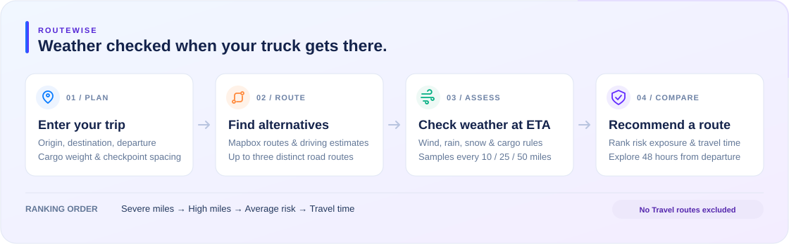

# RouteWise

A React + Django truck route planner that compares weather risk at checkpoint arrival times, using Mapbox routing and Open-Meteo forecasts.



## What it does

- Search US locations and compare up to three real route alternatives.
- Check wind, rain and snow every **10 / 25 / 50 miles**, including both endpoints.
- Show checkpoint weather, ETAs and the highest risk for each route.
- Explore **48 hours from departure** with a corridor heatmap, risk icons and an arrival marker.

## Run locally

Requires **Node 24+**, **Python 3.12+**, **uv**, and a Mapbox token.

```bash
cp .env.example .env
# Set MAPBOX_ACCESS_TOKEN in .env
uv sync
npm ci --prefix frontend
uv run python backend/manage.py runserver
```

In another terminal:

```bash
npm run dev --prefix frontend
```

Open **http://localhost:5173**. Django runs on port **8000**.
Optionally set `MAPBOX_PUBLIC_TOKEN` to a separate public `pk.` token for the browser map.

## Risk rules

Each checkpoint uses the highest wind, rain or snow risk, including cargo overrides.

| Score | Risk | Wind (mph) | Rain (in/hr) | Snow (in/hr) |
| --- | --- | --- | --- | --- |
| 0 | Low | <25 | <0.10 | <0.5 |
| 1 | Moderate | 25–<35 | 0.10–<0.25 | 0.5–<1.0 |
| 2 | High | 35–<45 | 0.25–<0.50 | 1.0–<2.0 |
| 3 | Severe | 45–<55 | 0.50–1.00 | 2.0–3.0 |
| 4 | No Travel | ≥55 | >1.00 | >3.0 |

**Cargo overrides:** wind 45–<55 mph with cargo over 30,000 lb means No Travel; wind 35–<45 mph with cargo over 40,000 lb means Severe.

**Route ranking:** fewest Severe miles → fewest High miles → lowest distance-weighted average risk → shortest travel time. No Travel routes are excluded; incomplete weather prevents a recommendation.

The sidebar shows each route's **highest checkpoint risk**. The forecast slider changes corridor weather only; route scores use checkpoint arrival times. Missing forecasts remain unavailable. ETAs exclude rest stops and truck-specific road restrictions.

## Checks

```bash
uv run pytest -q
uv run ruff check backend
npm test --prefix frontend
npm run build --prefix frontend
```

## Deploy

**Vercel:** import this branch with root `./` and preset **Services**. The included `vercel.json` serves React at `/` and Django at `/api`.
Set `MAPBOX_ACCESS_TOKEN`, `MAPBOX_PUBLIC_TOKEN`, `DJANGO_SECRET_KEY` and `DJANGO_DEBUG=false`. Add the deployed URL to the public Mapbox token's allowed URLs. See [deployment steps](docs/vercel-deployment.md).

**Docker / Render:**

```bash
docker build -t routewise .
docker run --rm -p 8000:8000 --env-file .env routewise
```

Render deployment is configured in `render.yaml`. Set the Mapbox tokens and allow the hosted URL in the public token's settings.

[Technical notes & API](docs/technical-notes.md) · [Walkthrough](docs/walkthrough.md)
